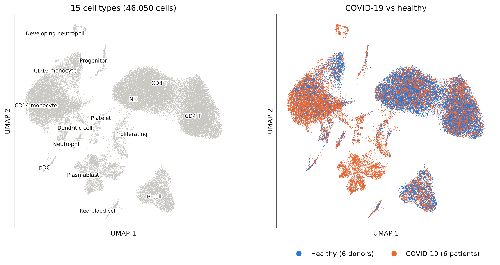
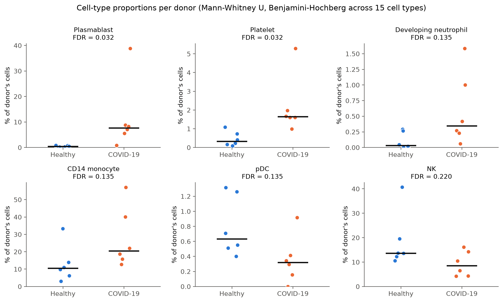
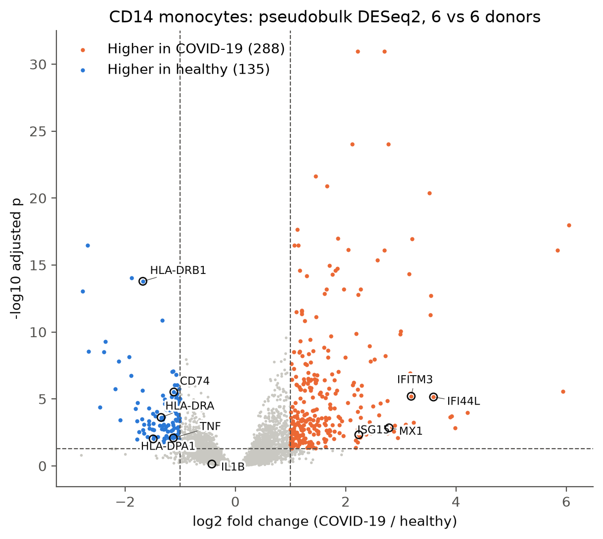
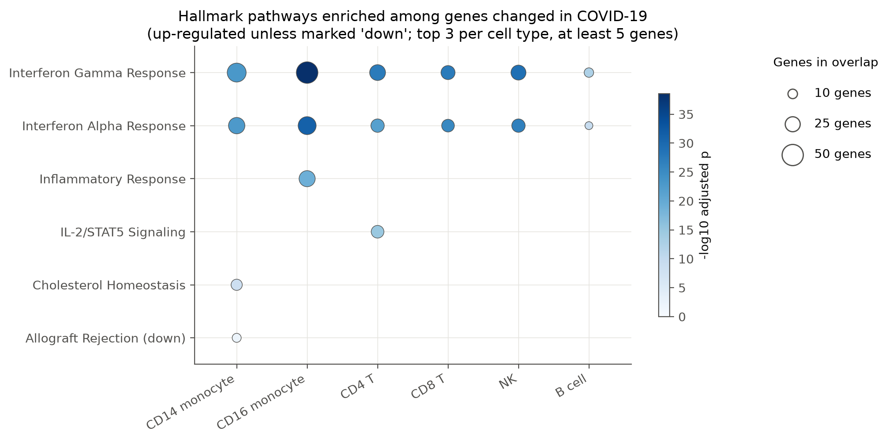
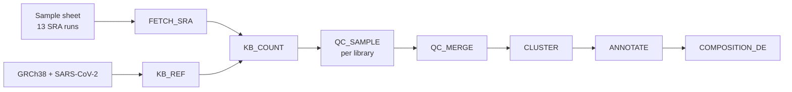
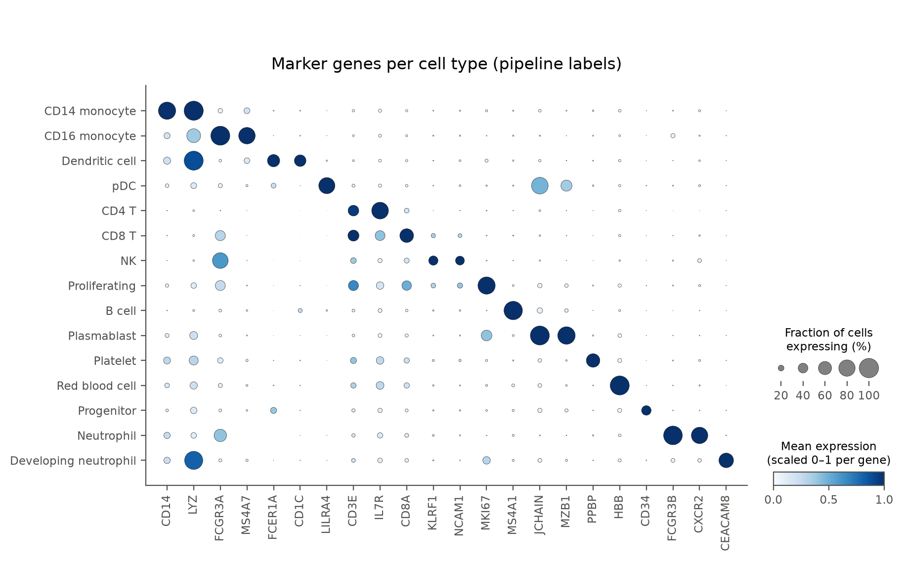

# Single-cell immune profiling of COVID-19 PBMCs

[](https://github.com/Pranavasri-RM/scrnaseq-covid-pbmc/actions/workflows/ci.yml)

An end-to-end single-cell RNA-seq (scRNA-seq) analysis of blood from patients hospitalized with COVID-19 and healthy donors, reprocessed from raw sequencing reads with a reproducible Nextflow pipeline. scRNA-seq measures which genes are active in each individual cell, so cells can be grouped into cell types and compared between patients and healthy donors. The samples are PBMCs (peripheral blood mononuclear cells: the white blood cells left after red cells and most neutrophils are removed).

The data are from Wilk et al. (2020), *Nature Medicine* ([GSE150728](https://www.ncbi.nlm.nih.gov/geo/query/acc.cgi?acc=GSE150728)): 13 Seq-Well libraries from 6 patients (one sampled twice) and 6 healthy donors. The aim was to reprocess the data from FASTQ files, compare the results with those reported in the paper, and package every step so it can run on a laptop (Docker) or an HPC cluster (SLURM + Apptainer).

## Key findings

- **46,050 cells grouped into 15 immune cell types** after quality control, Harmony integration and marker-based annotation (compared against CellTypist).
- **Plasmablasts (B cells that produce antibodies) are more frequent in patients**: a median of 7.7% of each patient's cells vs 0.4% in healthy donors (Mann-Whitney U, FDR 0.032), as also reported in the paper.
- **Platelets (cell fragments involved in clotting) are more frequent in patients**: patients 1.6% vs healthy donors 0.3% (FDR 0.032), with one patient at 5.3%. The paper does not report this difference.
- **Interferon response genes are higher in patients in all six cell types tested.** These are antiviral genes switched on when cells receive interferon signals. "Interferon gamma response" and "Interferon alpha response" are the top Hallmark pathways (curated gene sets for biological processes) in each cell type (pseudobulk DESeq2 with donors as replicates).
- **CD14 monocytes show lower expression of MHC class II genes** (HLA-DRA log2FC −1.35, HLA-DRB1 −1.68, CD74 −1.12). Monocytes use MHC class II to present pieces of pathogens to helper T cells. The inflammatory cytokine gene IL1B does not differ (padj 0.73), and TNF is lower in patients (log2FC −1.12). The paper also reports reduced HLA class II and no strong increase in pro-inflammatory cytokine genes in these monocytes.
- With 6 donors per group, differences in the proportions of CD14 monocytes, developing neutrophils, pDCs and NK cells did not pass FDR < 0.05 (see Limitations).

**Terms used above.** Cell-type proportions are the percentage of each donor's cells that belong to a cell type, summarized as the median per group. **FDR** (or **padj**) is a p-value adjusted for testing many cell types or genes at once; values below 0.05 are treated as significant. **log2FC** (log2 fold change) compares patients with healthy donors: +1 means twice as high in patients, −1 means half as high, and 0 means no difference.

## Results in figures



*Each dot is one cell, placed so that cells with similar gene expression sit close together. Left: the 15 cell types. Right: the same cells colored by patient (orange) or healthy donor (blue). Regions that are almost all orange, such as the plasmablasts, contain cells found mainly in patients.*



*Each dot is one donor, showing the percentage of that donor's cells that belong to the cell type; the black line is the median. The FDR for each comparison is given in the panel title.*



*Each dot is a gene tested in CD14 monocytes. Genes further right are higher in patients and genes further left are lower; genes higher up have stronger statistical evidence. Colored genes pass both cutoffs (dashed lines: padj < 0.05 and at least a 2-fold change). Labeled genes are the interferon, MHC class II and cytokine genes described above.*



*Each column is a cell type and each row a Hallmark pathway. A dot means the pathway is over-represented among the genes higher in patients (or lower, if marked "down"). Bigger dots contain more genes from the pathway; darker dots have stronger statistical evidence.*

## Pipeline

The workflow is written in Nextflow DSL2. Each step runs in a container, so the same code runs with Docker on a laptop or with Apptainer under SLURM on an HPC cluster; only the profile changes.



| Step | What it does |
|---|---|
| FETCH_SRA | Downloads the FASTQ files for each library from SRA |
| KB_REF | Builds a kallisto index from GRCh38 (Ensembl 110) with the SARS-CoV-2 genome added |
| KB_COUNT | Pseudoaligns reads and builds a cell x gene count matrix per library (kallisto \| bustools) |
| QC_SAMPLE | Applies per-library UMI and mitochondrial cutoffs (`assets/qc_cutoffs.csv`) and scores doublets with Scrublet |
| QC_MERGE | Combines the 13 libraries in sample-sheet order and removes genes seen in fewer than 10 cells |
| CLUSTER | Normalization, highly variable genes, PCA, Harmony integration by library, UMAP and Leiden clustering |
| ANNOTATE | Names clusters from `assets/cluster_labels.csv` after checking each cluster's marker gene, removes low-quality cells, splits NK and CD8 T cells by marker scores, and runs CellTypist for comparison |
| COMPOSITION_DE | Cell-type proportions per donor (Mann-Whitney U + Benjamini-Hochberg), pseudobulk DESeq2 per cell type, and Hallmark enrichment |

The analysis decisions (QC cutoffs, cluster names, the NK/CD8 split) were made in the notebooks in `notebooks/` and saved as files in `assets/`, which the pipeline reads. The notebooks show how each decision was reached; the pipeline produces the final results.

### Running it

Requirements: Nextflow 25.10.3 (Java 17), and Docker or Apptainer.

```bash
# Local, with Docker
nextflow run main.nf -profile docker

# HPC (SLURM + Apptainer)
nextflow run main.nf -profile hpc

# Quick check of the workflow wiring with placeholder data (no real computation)
nextflow run main.nf -stub -profile test
```

The full run was done on an HPC cluster (SLURM + Apptainer). KB_COUNT passes 60% of its memory request to `kb count` as a sort buffer (`-m`); with the default 24 GB request this is 14 GB, and most libraries peaked at about that level. In an earlier test run with a smaller buffer, one library (covid_555_2) completed with a 2 GB peak, so the memory requests in `nextflow.config` can be lowered for a machine with less RAM.

Results are written to `results/`. Add `-resume` to rerun only the steps whose inputs changed.

## Validation

### Against the authors' data

The authors deposited their own count matrices on GEO: one table per library giving, for each cell, how many RNA molecules (UMIs) came from each gene, produced by their dropEst pipeline and split into exonic and intronic counts. This allowed the counts produced here to be compared with theirs cell by cell, before any filtering. The comparisons below were computed in this project (`notebooks/00_authors_totals.R` and `notebooks/01_qc_exploration.ipynb`):

- The number of read pairs processed for each library matches the number listed for that run on SRA.
- The same cells are found: for covid_555_2, 7,083 of the authors' 7,106 cell barcodes are also present here.
- Per-cell totals agree in ranking (Spearman 0.946–0.989 across the 13 libraries): cells with many molecules in the authors' data also have many here.
- Totals here are lower, 80–100% of the authors' for the same cell. In the authors' matrices about 28% of molecules come from introns, and the kallisto index used here contains only spliced transcripts, so intronic reads are not counted. This also explains most of the low pseudoalignment rate (12–32% of reads assigned to a gene).

Cells were then filtered with the authors' published cutoffs: 1,000–15,000 UMIs per cell, and at most 20% of UMIs from mitochondrial genes (a higher share suggests a damaged cell). Because the same cell has fewer UMIs here than in the authors' matrices, the UMI cutoffs were scaled down for each library by the ratio between the two; for example, if a library's counts here are 90% of the authors', the lower cutoff becomes 900. With these cutoffs, 46,431 cells passed QC. For comparison, the original UMI cutoffs applied to the authors' own matrices keep 48,829 cells.

Cell types were named from marker genes, genes known to be specific to one cell type (for example CD14 for classical monocytes and MS4A1 for B cells). These names are recorded in `assets/cluster_labels.csv`. The paper's own cell labels are not in the GEO files, so as an independent check the cells were also labeled automatically with CellTypist (`Immune_All_Low`), a classifier trained on reference immune datasets. CellTypist agreed on most populations but labeled platelets, neutrophils and developing neutrophils as monocytes, so the marker-based names were kept. One cluster with nuclear lncRNAs, very few mitochondrial reads and high genes per UMI (consistent with nuclei that lost their cytoplasm) was removed, together with matching cells elsewhere (381 cells in total).



*Rows are cell types and columns are marker genes. A bigger dot means a larger fraction of the cells in that group express the gene; a darker dot means higher average expression (scaled per gene). The diagonal pattern shows that each cell type expresses its own markers.*

### Notebooks vs pipeline

The analysis was first developed step by step in Jupyter notebooks, and each step was then turned into a script that the pipeline runs. To check that nothing changed in the move, each script was run on the same data and on the same Mac as its notebook, and the outputs were compared. The same cells passed QC, cells were assigned to the same clusters and given the same cell-type names, and the DE tables were identical. One difference was found and fixed this way: rounding the QC cutoffs had let 10 extra cells through.

Running the same code on a Mac (ARM) and inside the Linux container (x86) gave small differences:

- **Leiden clusters were numbered differently.** The groupings themselves were nearly the same (adjusted Rand index 0.984, where 1 means identical groupings), with the same 15 populations. Because the cluster-to-name table is keyed by cluster number, the first full run on the HPC put names on the wrong clusters without any error. `annotate.py` now checks that each cluster's listed marker gene is highest in that cluster and stops if not.
- **The NK/CD8 T split** is made from per-cell marker scores smoothed over the neighbor graph; it agrees for 98.3% of these cells between the two platforms.
- **DESeq2's independent filtering** (which leaves very low-expressed genes out of the multiple-testing correction) chose a slightly different cutoff, so a few low-expressed genes have an adjusted p-value on one platform and none on the other. Fold changes and unadjusted p-values are identical.

All numbers in this README come from the pipeline run inside the container, because that environment can be rerun exactly.

### Tests and CI

GitHub Actions runs two jobs on every push:

- **Unit tests** (`tests/`, pytest) inside the same container the pipeline uses. Each test covers a problem that came up during the project: cluster labels that don't match the clustering, libraries combined out of sample-sheet order, an unexpected input file, the significance filter (padj < 0.05 and |log2FC| > 1), the antibody-gene filter, and the NK/CD8 split.
- **A Nextflow stub run** (`-stub -profile test`), where each process only creates empty output files. This checks that the steps connect and the configuration resolves; it does not test the analysis itself.

The full data (about 2.5 billion read pairs) is too large for CI, so the analysis was checked by the comparisons above instead.

## Limitations

- **6 patients vs 6 healthy donors.** Donors are the unit of replication, so only large, consistent differences pass multiple-testing correction. Two differences reported in the paper, fewer pDCs and more developing neutrophils, have p < 0.05 here but do not pass correction.
- **Disease and processing batch cannot be separated.** Each library comes from a single donor and condition. Harmony was used only for clustering and annotation; all disease comparisons use raw counts per donor.
- **covid_555 was sampled twice** (patient C1 in the paper: 9 days after symptom onset on supplemental oxygen, and 11 days after onset following intubation). The two libraries were combined into one donor, which mixes two clinical states.
- **Ambient RNA was not removed.** Antibody genes from plasmablasts appear as "up-regulated" in T and NK cells; these genes were excluded from pathway enrichment but remain in the DE tables.
- **Doublets were scored but not removed.** The Scrublet score distribution had no clear threshold, and no cluster had high scores.
- **Proportions are tested one cell type at a time.** They sum to 100% per donor, so an expansion of one type lowers the others; methods such as scCODA or propeller model this.
- **The NK result depends on how NK and CD8 T cells are separated.** With the earlier, classifier-based split in the notebooks, NK depletion had p = 0.041; with the final marker-score split it has p = 0.132.
- **Patient-to-patient variation is averaged out.** The paper reports that the interferon response varies between patients; pseudobulk DE gives the overall difference per cell type.
- **Clinical variables** (severity, ventilation, days since onset) are in the paper but not on GEO, and were not used.
- **Intronic reads are not counted**, so per-cell totals are 80–100% of the authors'.

## Repository layout

```
main.nf, nextflow.config     workflow and resource settings
conf/                        HPC (SLURM + Apptainer) and test profiles
modules/                     one Nextflow process per step
bin/                         Python scripts the processes run
assets/                      sample sheet, QC cutoffs, cluster labels, SARS-CoV-2 reference
containers/                  Dockerfiles for the kb-python and analysis images
notebooks/                   exploration: QC, clustering, annotation, composition and DE
scripts/make_figures.py      README figures from the pipeline results
figures/                     README figures
tests/                       unit tests and stub-run inputs
.github/workflows/ci.yml     GitHub Actions
```

The notebooks were run on macOS, so their numbers differ slightly from the pipeline results above (see Validation).

## Data and citation

Wilk, A.J., Rustagi, A., Zhao, N.Q. et al. A single-cell atlas of the peripheral immune response in patients with severe COVID-19. *Nature Medicine* 26, 1070–1076 (2020). https://doi.org/10.1038/s41591-020-0944-y

Raw reads: SRA runs SRR11804718–SRR11804730 (GEO [GSE150728](https://www.ncbi.nlm.nih.gov/geo/query/acc.cgi?acc=GSE150728)).